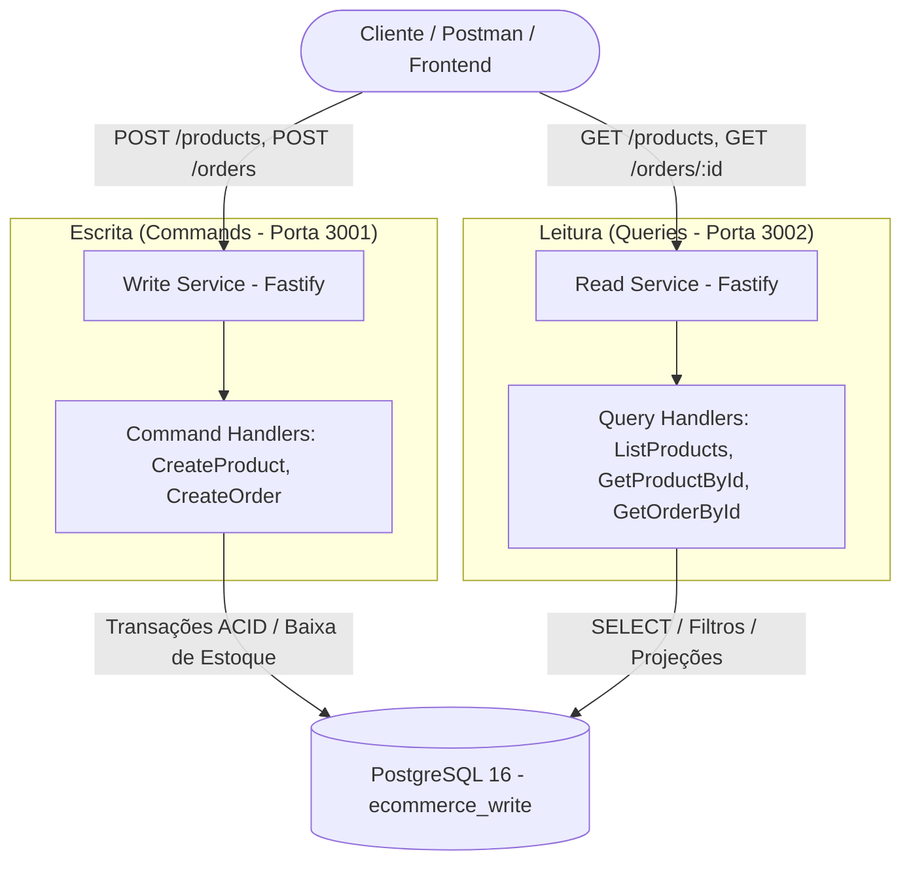

# E-Commerce CQRS & CDC Architecture Lab

Um projeto prático de arquitetura distribuída focado na implementação e evolução progressiva dos padrões **CQRS** (*Command Query Responsibility Segregation*), **Event-Driven Architecture** e **CDC** (*Change Data Capture* via Debezium e Outbox Pattern) utilizando **Node.js**, **TypeScript**, **PostgreSQL**, **MongoDB** e **Docker**.

---

## 🎯 Por que esta arquitetura?

A maioria dos sistemas nasce como um monólito CRUD tradicional onde leituras e escritas compartilham o mesmo banco e o mesmo modelo de dados. Conforme o sistema cresce, surgem conflitos:
1. **Contenção de Recursos**: Relatórios e listagens pesadas de catálogo degradam a performance de checkout e criação de pedidos.
2. **Modelos Conflitantes**: O modelo ideal para escrita (normalizado, ACID, focado em consistência de estoque) é o oposto do modelo ideal para leitura (desnormalizado, agregado, focado em velocidade de busca).
3. **Escala Desbalanceada**: Em e-commerces, a proporção de leitura para escrita costuma ultrapassar 100:1.

Este projeto resolve esses problemas segregando a responsabilidade de comandos (escrita) e consultas (leitura), evoluindo passo a passo para sincronização assíncrona orientada a eventos.

---

## 🗺️ Roadmap de Evolução Arquitetural

| Fase | Descrição | Status | Branch |
| :--- | :--- | :---: | :--- |
| **Fase 1** | **Write Service + PostgreSQL**: Modelagem relacional, Commands, Handlers e transações ACID | 🟢 Concluído | `feature/phase-1-write-service-cqrs` |
| **Fase 2** | **Read Service**: Segregação de Query Handlers no mesmo banco (CQRS a nível de código/processo) | 🟢 Concluído | `feature/phase-2-read-service` |
| **Fase 3** | **API Gateway**: Roteamento transparente de comandos e queries | ⚪ Planejado | `feature/phase-3-api-gateway` |
| **Fase 4** | **Banco de Leitura Separado**: MongoDB + Worker consumidor + Mensageria assíncrona | ⚪ Planejado | `feature/phase-4-read-db-messaging` |
| **Fase 5** | **CDC com Debezium + Outbox Pattern**: Garantia de entrega atômica sem 2PC (*Two-Phase Commit*) | ⚪ Planejado | `feature/phase-5-cdc-outbox` |
| **Fase 6** | **Observabilidade, Testes & CI/CD**: OpenTelemetry/Prometheus, testes automatizados e GitHub Actions | ⚪ Planejado | `feature/phase-6-observability-ci` |

---

## 🏗️ Visão Geral da Arquitetura (Fase 2)



---

## 🚀 Como Executar Localmente

### Opção 1: Execução com Apenas Um Comando (Recomendado)

O projeto está 100% containerizado com Docker Compose e executa as migrações automaticamente:

```bash
docker compose up --build
```

Os serviços estarão imediatamente disponíveis:
* **Write Service**: `http://localhost:3001`
* **Read Service**: `http://localhost:3002`
* **PostgreSQL**: `localhost:5432`

---

### Opção 2: Execução Manual para Desenvolvimento

1. **Subir o banco PostgreSQL:**
   ```bash
   docker compose up -d postgres
   ```

2. **Instalar as dependências do monorepo:**
   ```bash
   npm install
   ```

3. **Executar migrações do Prisma:**
   ```bash
   cd services/write-service
   npx prisma migrate dev
   ```

4. **Executar os serviços em terminais separados:**
   ```bash
   # Terminal 1 - Write Service (Porta 3001)
   npm run dev --workspace=@ecommerce/write-service

   # Terminal 2 - Read Service (Porta 3002)
   npm run dev --workspace=@ecommerce/read-service
   ```

---

## 🧪 Testes Automatizados

O repositório conta com uma suíte de testes unitários rápidos e determinísticos cobrindo regras de negócio, invariantes de estoque e projeções de queries:

```bash
# Executar todos os testes do monorepo
npm test
```

Pipeline configurado no GitHub Actions em [`.github/workflows/ci.yml`](./.github/workflows/ci.yml).

---

## 📬 Coleção de Requisições e Exemplos

Você pode importar a coleção completa do Postman localizada em:
📁 [`docs/ecommerce-cqrs-cdc.postman_collection.json`](./docs/ecommerce-cqrs-cdc.postman_collection.json)

### 1. Criar Produto (Write Service - Porta 3001)
```bash
curl -X POST http://localhost:3001/products \
  -H "Content-Type: application/json" \
  -d '{
    "name": "Teclado Mecânico RGB",
    "description": "Switch Brown silencioso ABNT2",
    "price": 350.00,
    "stock": 10
  }'
```

### 2. Criar Pedido com Baixa Atômica de Estoque (Write Service - Porta 3001)
```bash
curl -X POST http://localhost:3001/orders \
  -H "Content-Type: application/json" \
  -d '{
    "customerName": "Tiago Ferreira",
    "items": [
      {
        "productId": "<PRODUCT_ID>",
        "quantity": 2
      }
    ]
  }'
```

### 3. Listar Produtos com Filtros Opcionais (Read Service - Porta 3002)
```bash
curl "http://localhost:3002/products?search=Teclado&minPrice=100&maxPrice=500"
```

### 4. Consultar Detalhes do Pedido com Projeções Agregadas (Read Service - Porta 3002)
```bash
curl "http://localhost:3002/orders/<ORDER_ID>"
```

---

## 🏛️ Decisões Arquiteturais Registradas (ADRs)

* [ADR 001 - Fastify e TypeScript para os Microsserviços](./docs/adr/001-fastify-typescript.md)
* [ADR 002 - PostgreSQL com Driver Adapter no Prisma 7](./docs/adr/002-prisma-pg-adapter.md)
* [ADR 003 - Segregação CQRS no Mesmo Banco Inicial](./docs/adr/003-cqrs-same-database-first.md)

---

## ⚠️ Limitações e Escopo de Estudo

> **Nota de Transparência:** Este projeto é um laboratório de estudos arquiteturais focado em padrões distribuídos (CQRS, CDC e Event-Driven). Para manter o escopo enxuto e demonstrar as garantias de consistência e mensageria, propositalmente foram omitidas autenticações complexas (OAuth2/JWT) e gateways de pagamento reais. Em um e-commerce em escala real com volume modesto, um CRUD monolítico modularizado poderia ser suficiente; este projeto foi construído para cenários de alta assimetria de leitura/escrita e necessidade de desacoplamento de storage.
