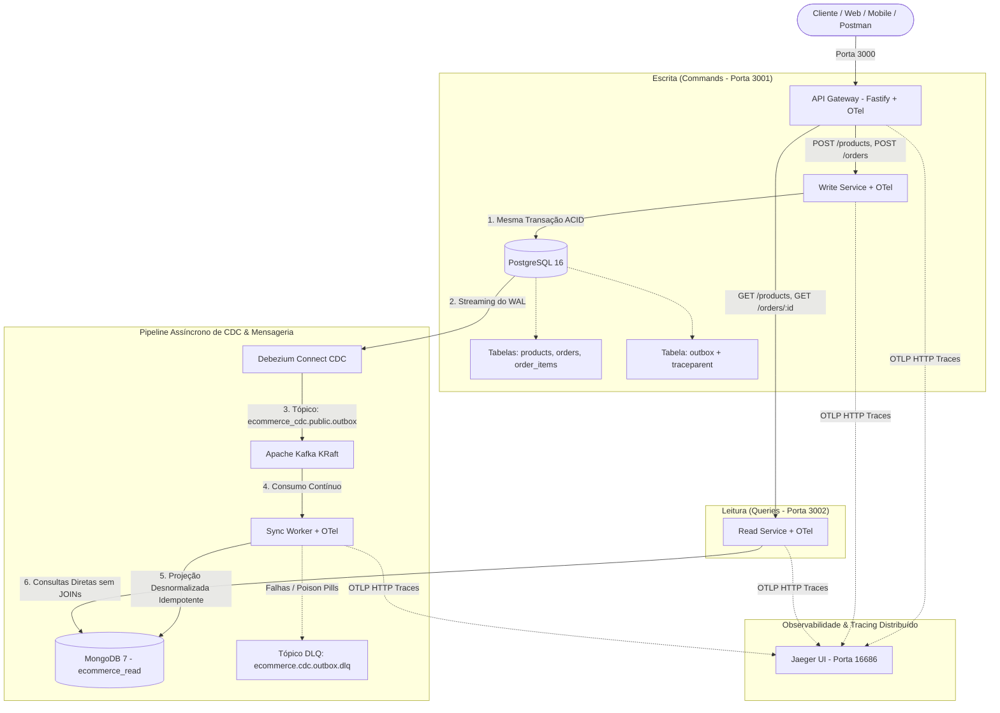

# E-Commerce CQRS & CDC Architecture Lab

Laboratório de arquitetura distribuída demonstrando a implementação progressiva dos padrões **CQRS** (*Command Query Responsibility Segregation*), **API Gateway**, **Transactional Outbox Pattern**, **Change Data Capture (CDC)** com Debezium, **Apache Kafka (KRaft)**, persistência poliglota com **PostgreSQL** e **MongoDB**, e **Observabilidade Distribuída** com **OpenTelemetry** e **Jaeger**.

---

## 🎯 O Problema que a Arquitetura Resolve

Em aplicações de comércio eletrônico, a proporção entre consultas de catálogo e compras reais costuma ultrapassar 100 para 1. 

Manter leituras e escritas no mesmo banco relacional traz gargalos conhecidos:
* **Concorrência de recursos**: consultas pesadas de busca e relatórios competem por CPU, memória e conexões com o checkout e a baixa de estoque.
* **Modelos de dados opostos**: a escrita exige dados normalizados para garantir integridade e evitar inconsistências (ACID). A leitura se beneficia de dados desnormalizados e agregados para responder rápido sem múltiplos JOINs.
* **O Risco do Dual-Write**: tentar gravar no banco e enviar para a mensageria manualmente na aplicação cria falhas de consistência quando a rede ou o broker oscilam.
* **Invisibilidade em Pipelines Assíncronos**: em sistemas orientados a eventos, rastrear onde uma mensagem travou ou calcular o tempo exato de propagação exige instrumentação padronizada (OpenTelemetry) e proteção contra poison pills (Dead Letter Queue).

Este projeto resolve esses pontos separando as rotas de comando e consulta via API Gateway, garantindo sincronização confiável através do **Transactional Outbox Pattern** com **Debezium CDC**, **Kafka**, isolamento via **DLQ** e rastreamento com **OpenTelemetry**.

---

## 🗺️ Roadmap de Evolução Arquitetural

| Fase | Descrição | Status | Branch |
| :--- | :--- | :---: | :--- |
| **Fase 1** | **Write Service + PostgreSQL**: Modelagem relacional, Commands, Handlers e transações ACID | 🟢 Concluído | `feature/phase-1-write-service-cqrs` |
| **Fase 2** | **Read Service**: Segregação de Query Handlers no mesmo banco (CQRS a nível de código/processo) | 🟢 Concluído | `feature/phase-2-read-service` |
| **Fase 3** | **API Gateway**: Roteamento transparente de comandos e queries em porta única (3000) | 🟢 Concluído | `feature/phase-3-api-gateway` |
| **Fase 4** | **CDC, Outbox & Polyglot Persistence**: Transactional Outbox + Debezium + Kafka + MongoDB + Sync Worker | 🟢 Concluído | `feature/phase-4-cdc-kafka-mongo` |
| **Fase 5** | **Observabilidade, Tracing Distribuído & Resiliência**: OpenTelemetry W3C TraceContext, Jaeger e DLQ | 🟢 Concluído | `feature/phase-5-observability-resilience` |

---

## 🏗️ Visão da Arquitetura Completa



---

## 🚀 Como Executar Localmente

### Opção 1: Executar com Um Comando (Recomendado)

O projeto está configurado no Docker Compose para subir todo o ecossistema distribuído de forma automatizada, incluindo migrações do banco, conector CDC e Jaeger:

```bash
docker compose up --build
```

Serviços disponíveis após inicialização:
* **API Gateway (Entrada única)**: `http://localhost:3000`
* **Jaeger Web UI (Tracing Distribuído)**: `http://localhost:16686`
* **Write Service (Comandos de escrita)**: `http://localhost:3001`
* **Read Service (Consultas MongoDB)**: `http://localhost:3002`
* **Debezium Connect REST API**: `http://localhost:8083`
* **PostgreSQL (Storage transacional)**: `localhost:5432`
* **MongoDB (Storage de leitura)**: `localhost:27017`
* **Apache Kafka (Message broker)**: `localhost:9092`

---

### Opção 2: Execução Manual para Desenvolvimento

1. **Subir os storages, brokers e Jaeger no Docker:**
   ```bash
   docker compose up -d postgres mongodb kafka debezium debezium-init jaeger
   ```

2. **Instalar dependências e compilar o monorepo:**
   ```bash
   npm install
   npm run build
   ```

3. **Rodar migrações do Prisma no Write Service:**
   ```bash
   cd services/write-service
   npx prisma migrate dev
   ```

4. **Iniciar os microsserviços e workers:**
   ```bash
   # Terminal 1 - Write Service (3001)
   npm run dev --workspace=@ecommerce/write-service

   # Terminal 2 - Sync Worker (Consumidor Kafka)
   npm run dev --workspace=@ecommerce/sync-worker

   # Terminal 3 - Read Service (3002)
   npm run dev --workspace=@ecommerce/read-service

   # Terminal 4 - API Gateway (3000)
   npm run dev --workspace=@ecommerce/api-gateway
   ```

---

## 🧪 Testes Automatizados & Verificação E2E

### 1. Testes Unitários e de Integração
O monorepo conta com **26 testes automatizados** cobrindo regras de negócio, transações com outbox, parse de envelopes Debezium CDC, resiliência com Dead Letter Queue, projeções MongoDB e roteamento do Gateway:

```bash
npm test
```

Pipeline contínuo configurado no GitHub Actions em [`.github/workflows/ci.yml`](./.github/workflows/ci.yml).

### 2. Verificação Automatizada da Consistência Eventual (E2E)
Com o ambiente rodando no Docker Compose, execute o script automatizado para comprovar o ciclo completo de sincronização e aferir o lag de replicação em milissegundos:

```bash
npm run verify:e2e
```

O script dispara a criação de um produto e um pedido no Gateway, monitora o momento exato em que a projeção desnormalizada reflete no MongoDB e emite um relatório com o lag medido da esteira CDC.

---

## 📬 Exemplos de Requisição via API Gateway (Porta 3000)

Importe a coleção do Postman:
📁 [`docs/ecommerce-cqrs-cdc.postman_collection.json`](./docs/ecommerce-cqrs-cdc.postman_collection.json)

### 1. Healthcheck Consolidado
```bash
curl http://localhost:3000/health
```

### 2. Criar Produto (Command -> Write Service -> Outbox -> Debezium -> Kafka -> Mongo)
```bash
curl -X POST http://localhost:3000/products \
  -H "Content-Type: application/json" \
  -d '{
    "name": "Teclado Mecânico RGB",
    "description": "Switch Brown silencioso ABNT2",
    "price": 350.00,
    "stock": 10
  }'
```

### 3. Criar Pedido com Baixa de Estoque e Registro Outbox
```bash
curl -X POST http://localhost:3000/orders \
  -H "Content-Type: application/json" \
  -d '{
    "customerName": "Tiago Ferreira",
    "items": [
      {
        "productId": "<PRODUCT_ID>",
        "quantity": 2
      }
    ]
  }'
```

### 4. Listar Produtos Diretamente do MongoDB (Query -> Read Service)
```bash
curl "http://localhost:3000/products?search=Teclado&minPrice=100&maxPrice=500"
```

### 5. Consultar Pedido com Dados Desnormalizados do MongoDB (Query -> Read Service)
```bash
curl "http://localhost:3000/orders/<ORDER_ID>"
```

### 6. Inspecionar Tracing no Jaeger UI
Abra seu navegador em:
```
http://localhost:16686
```
Selecione o serviço `api-gateway` e veja o fluxo da requisição HTTP se desdobrando no Write Service, no Outbox e no Sync Worker.

---

## 🏛️ Decisões Arquiteturais (ADRs)

* [ADR 001 - Fastify e TypeScript para os Microsserviços](./docs/adr/001-fastify-typescript.md)
* [ADR 002 - PostgreSQL com Driver Adapter no Prisma 7](./docs/adr/002-prisma-pg-adapter.md)
* [ADR 003 - CQRS a Nível de Código no Mesmo Banco Inicial](./docs/adr/003-cqrs-same-database-first.md)
* [ADR 004 - API Gateway com Fastify e Proxy Reverso](./docs/adr/004-api-gateway-reverse-proxy.md)
* [ADR 005 - Eliminação do Dual-Write com Transactional Outbox e Debezium CDC](./docs/adr/005-transactional-outbox-cdc.md)
* [ADR 006 - Observabilidade com OpenTelemetry, Jaeger e Resiliência com Dead Letter Queue (DLQ)](./docs/adr/006-observability-resilience-dlq.md)

---

## ⚠️ Escopo e Limitações

Para um e-commerce pequeno ou com volume moderado de acessos, adotar microsserviços distribuídos com CQRS e mensageria seria overengineering — um monolito modular bem estruturado resolveria o problema com menos custo operacional. 

Este projeto foi construído como um laboratório prático para estudar e demonstrar padrões de arquitetura distribuída onde a separação física entre leitura e escrita é realmente necessária. Autenticação complexa (OAuth2/JWT) e gateways de pagamento externos foram deliberadamente deixados fora para manter o foco estritamente na arquitetura de dados e mensageria.
