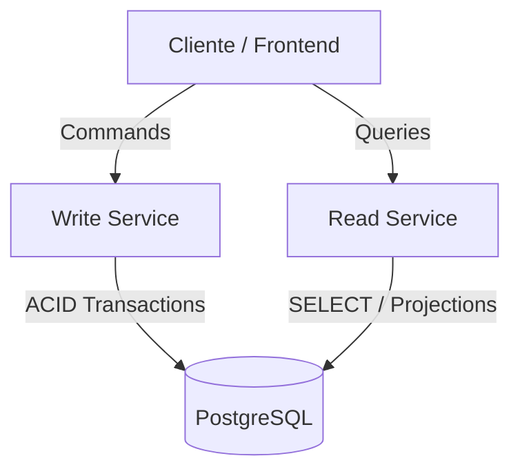

# ADR 003: Segregação de Responsabilidade (CQRS) no Mesmo Banco de Dados Inicial

## Status
Aceito

## Contexto
O padrão **CQRS** (*Command Query Responsibility Segregation*) estabelece que os caminhos de escrita (Commands) e de leitura (Queries) devem ser tratados como responsabilidades distintas. Frequentemente, arquitetos e desenvolvedores assumem erroneamente que implementar CQRS exige de imediato bancos de dados fisicamente separados, mensageria (Kafka/RabbitMQ) e consistência eventual.

No entanto, introduzir dois bancos e mensageria no Dia 1 traz uma complexidade operacional imensa:
* Consistência eventual precoce (o usuário cria um pedido e não o enxerga imediatamente).
* Falhas de rede entre o broker e os workers de sincronização.
* Sobrecarga de manutenção de infraestrutura antes da necessidade real de escala.

## Decisão
Implementamos a **Fase 2 da evolução arquitetural com CQRS a nível de código/processo**, onde:
1. O `write-service` executa comandos (`CreateProductCommand`, `CreateOrderCommand`), mantendo o modelo normalizado, validando regras de negócio e abrindo transações ACID.
2. O `read-service` executa consultas (`ListProductsQuery`, `GetOrderByIdQuery`), otimizado para agregações, projeções e buscas parametrizadas.
3. **Ambos os serviços leem e escrevem no mesmo banco relacional (PostgreSQL)** nesta fase.

### Por que esta decisão é superior a um CRUD monolítico?
* **Modelos Conceituais Distintos**: O Write Service não expõe rotas de listagem nem projeta views. O Read Service é estritamente *read-only* e não possui métodos de mutação.
* **Escala Horizontal Desacoplada**: Podemos escalar o `read-service` com 5 containers para atender à alta taxa de leitura (proporção 95:5 em relação a compras), mantendo 1 instância do `write-service`.
* **Zero Risco de Inconsistência**: Como compartilham o mesmo banco ACID, o cliente tem consistência forte imediata.
* **Caminho Suave para Projeções Desnormalizadas**: Na Fase 4 e 5, o `read-service` poderá apontar para um banco NoSQL (ex: MongoDB) e receber eventos via CDC sem que o cliente ou o domínio de negócio sofram impacto estrutural.

## Consequências
### Positivas
* Simplicidade de deploy e depuração inicial.
* Não há latência de sincronização nem perda de eventos.
* Código 100% alinhado com a semântica do CQRS (Commands retornam apenas identificadores/status; Queries retornam DTOs específicos de leitura).

### Negativas / Mitigações
* Ambos os serviços ainda competem por conexões e IOPS no mesmo PostgreSQL. Essa limitação será resolvida nas Fases 4 e 5 com o banco de leitura separado e CDC.
