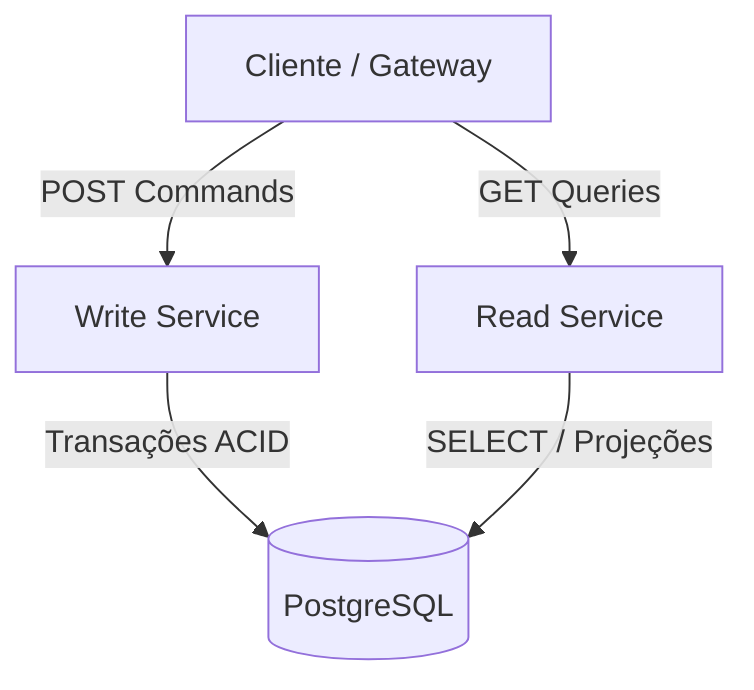

# ADR 003: CQRS a Nível de Código no Mesmo Banco Inicial

## Status
Aceito

## Contexto
O padrão CQRS (*Command Query Responsibility Segregation*) prega a separação entre quem altera o estado do sistema (comandos) e quem apenas consulta (queries). 

Muitas implementações tentam pular etapas, introduzindo múltiplos bancos de dados (ex: Postgres + Mongo) e mensageria (Kafka/RabbitMQ) desde o primeiro commit. Para o estágio inicial do projeto, essa abordagem traz custos operacionais desnecessários:
* **Consistência eventual imediata**: o usuário finaliza a compra e a listagem pode não refletir o pedido de imediato caso haja atraso na fila.
* **Infraestrutura pesada**: necessidade de monitorar brokers, tratar mensagens mortas (dead-letter queues) e lidar com dessincronização entre bancos.
* **Dificuldade de depuração**: rastrear bugs entre eventos assíncronos é muito mais complexo do que em chamadas diretas.

## Decisão
Na **Fase 2**, implementamos a segregação de responsabilidade **apenas a nível de código e processos**, mantendo ambos os serviços acessando a mesma instância do PostgreSQL:
1. O `write-service` executa comandos (`CreateProductCommand`, `CreateOrderCommand`), mantendo o modelo normalizado e abrindo transações ACID.
2. O `read-service` executa consultas (`ListProductsQuery`, `GetOrderByIdQuery`), focado em filtros, paginação e projeções de dados prontas para a tela.
3. Não há escrita no serviço de leitura, nem listagens ou agregações no serviço de escrita.

### Por que fazer assim primeiro?
* **Separação conceitual limpa**: os modelos de domínio de escrita não se misturam com as necessidades de exibição das telas.
* **Escala independente**: a leitura costuma ter um volume muito maior do que a compra. Podemos rodar mais réplicas do container de leitura sem precisar duplicar o serviço de escrita.
* **Sem risco de inconsistência**: como o banco ainda é o mesmo, o cliente consulta o pedido com garantia de consistência forte.
* **Facilidade de evolução**: quando migrarmos a leitura para MongoDB e mensageria nas fases 4 e 5, o contrato das queries já estará pronto e isolado, sem necessidade de reescrever a lógica das rotas.

## Consequências
### Positivas
* Código organizado exatamente de acordo com os princípios de CQRS.
* Testes simples e rápidos, sem depender de brokers de mensagens rodando localmente.
* Zero latência de sincronização neste estágio.

### Negativas / Trade-offs
* O banco de dados continua sendo um ponto único de contenção de conexões e I/O de disco. Essa divisão física de storages será realizada nas fases seguintes.
