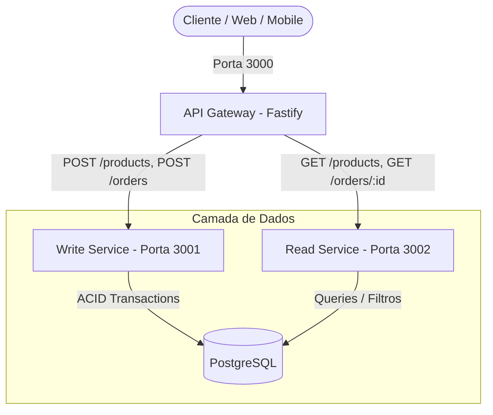

# ADR 004: Implementação de API Gateway com Fastify e Proxy Reverso Declarativo

## Status
Aceito

## Contexto
Com a segregação física entre o `write-service` (porta 3001) e o `read-service` (porta 3002), surgiu a necessidade de definir como os clientes externos (Aplicações React/Next.js, aplicativos móveis e ferramentas de API) consom esses microsserviços.

Sem um ponto de entrada unificado:
1. **Acoplamento à Topologia de Rede**: O cliente precisa saber qual serviço executa em qual porta ou IP.
2. **Superfície de Ataque e CORS**: Múltiplos serviços precisam gerenciar regras de CORS, portas públicas e políticas de segurança.
3. **Impossibilidade de Evolução Transparente**: Se o `read-service` for substituído por outro storage (ex: MongoDB ou Elasticsearch) ou receber balanceamento de carga, os clientes precisariam ser alterados.

## Decisão
Implementamos um **API Gateway** na pasta `services/api-gateway` utilizando **Fastify** com os plugins `@fastify/http-proxy` e `@fastify/cors`, expondo uma porta única (`3000`).

### Por que Fastify + `@fastify/http-proxy` em vez de Nginx/Kong nesta fase?
* **Testabilidade e Automação de CI**: O Gateway escrito em TypeScript pode ser 100% coberto por testes unitários e de integração (`test/gateway.spec.ts`) usando injeção em memória (`app.inject()`), executando em ~200ms no GitHub Actions sem depender de contêineres adicionais de proxy.
* **Streaming de Alta Performance**: O `@fastify/http-proxy` utiliza o engine `fast-proxy`, transmitindo payloads e chunks via streams sem carregar o corpo das requisições desnecessariamente na memória do processo Node.js.
* **Healthcheck Agregador Inteligente**: O endpoint `GET /health` do Gateway realiza sondagem paralela aos serviços downstream (`write-service` e `read-service`) e responde com status consolidado (`ok` ou `degraded`).

## Consequências
### Positivas
* O cliente consome uma única URL base (`http://localhost:3000`).
* Políticas de CORS centralizadas em um único local.
* Encapsulamento completo da evolução arquitetural: o cliente não percebe quando a leitura migrar para MongoDB na Fase 4.

### Negativas / Mitigações
* Adiciona um salto de rede (*hop*) adicional entre o cliente e o microsserviço de destino. Em ambiente local e Kubernetes, a latência do Fastify proxy fica na casa de submilisegundos (~0.5ms), sendo um trade-off plenamente justificável pelo desacoplamento.
