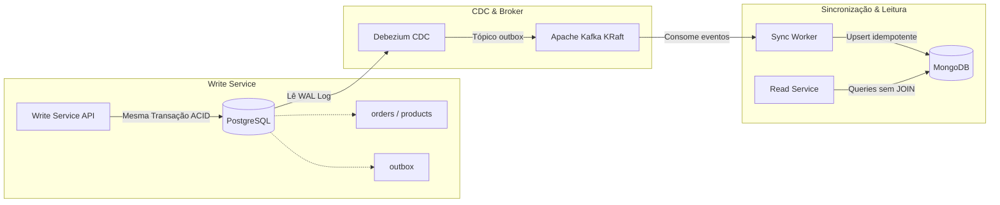

# ADR 005: Eliminação do Dual-Write com Transactional Outbox e Debezium CDC

## Status
Aceito

## Contexto
Na Fase 3, o `read-service` e o `write-service` compartilhavam a mesma instância do PostgreSQL. Embora o código já estivesse segregado em comandos e consultas (CQRS), o banco relacional continuava sendo um ponto único de contenção.

Para separar fisicamente o armazenamento de leitura no MongoDB, precisamos sincronizar os dados entre os bancos.

A abordagem ingênua seria o **Dual-Write** direto na aplicação:
```ts
await prisma.order.create(...);        // 1. Salva no Postgres
await kafkaProducer.send(event);       // 2. Publica no Kafka
```

Essa abordagem falha em cenários reais:
* Se o processo cair ou a rede falhar entre o passo 1 e o passo 2, o pedido existe no PostgreSQL, mas o evento nunca chega ao Kafka. O MongoDB fica **permanentemente dessincronizado**.
* Se invertermos a ordem (enviar ao Kafka primeiro), qualquer falha de validação ou concorrência no Postgres deixará uma mensagem fantasma no Kafka, gravando dados corrompidos na leitura.

## Decisão
Adotamos o **Transactional Outbox Pattern** em conjunto com **Change Data Capture (CDC)** via **Debezium** e **Apache Kafka (KRaft)**:



### Como funciona:
1. **Gravação Atômica na Outbox**: toda alteração de estado no `write-service` grava a entidade (`Order` ou `Product`) e um registro na tabela `outbox` sob a **mesma transação ACID** do PostgreSQL.
2. **Captura via WAL (Debezium)**: o Debezium se conecta à replicação lógica do PostgreSQL (`wal_level=logical`) e lê as alterações confirmadas no disco, publicando no tópico `ecommerce_cdc.public.outbox` do Kafka com garantia de entrega *at-least-once*.
3. **Consumo e Projeção Idempotente (Sync Worker)**: o serviço `sync-worker` escuta o tópico do Kafka, faz o parse do payload do Debezium e projeta os dados no MongoDB usando operações de `upsert` com `_id` fixo, garantindo que reentregas de mensagens não dupliquem registros.
4. **Leitura Desacoplada**: o `read-service` passa a consultar unicamente o MongoDB, com documentos desnormalizados e índices em memória.

## Consequências
### Positivas
* **Eliminação do Dual-Write**: impossível persistir um pedido sem registrar seu evento correspondente.
* **Isolamento total de I/O**: buscas intensas no catálogo e leitura de pedidos não consom conexões nem disco do PostgreSQL.
* **Replay de Eventos**: se o MongoDB precisar ser reconstruído ou se criarmos novos serviços de projeção, o Kafka mantém o histórico ordenado para reprocessamento.

### Negativas / Trade-offs
* **Consistência Eventual**: existe uma latência de sincronização de frações de segundo entre o commit no Postgres e a atualização no MongoDB. Para o fluxo de e-commerce (onde o cliente aguarda o redirecionamento de confirmação), esse intervalo é imperceptível.
* **Infraestrutura**: adiciona contêineres para Kafka, Debezium e MongoDB. Mitigamos o peso operacional usando Kafka em modo KRaft (sem ZooKeeper) e scripts de registro automático do conector.
